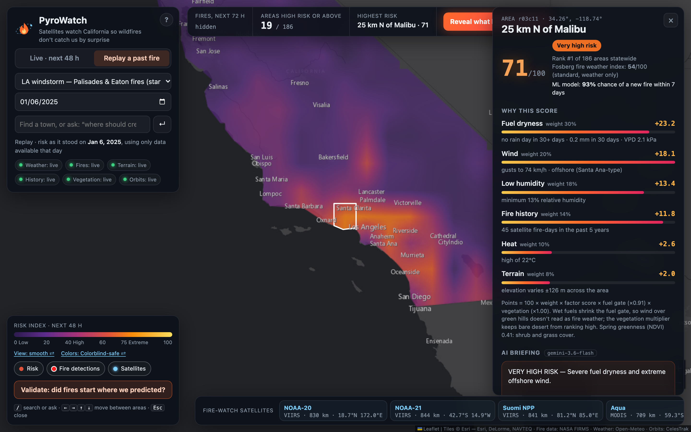
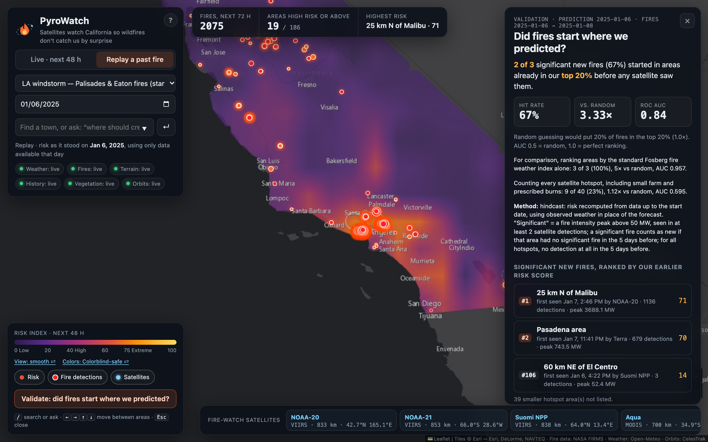
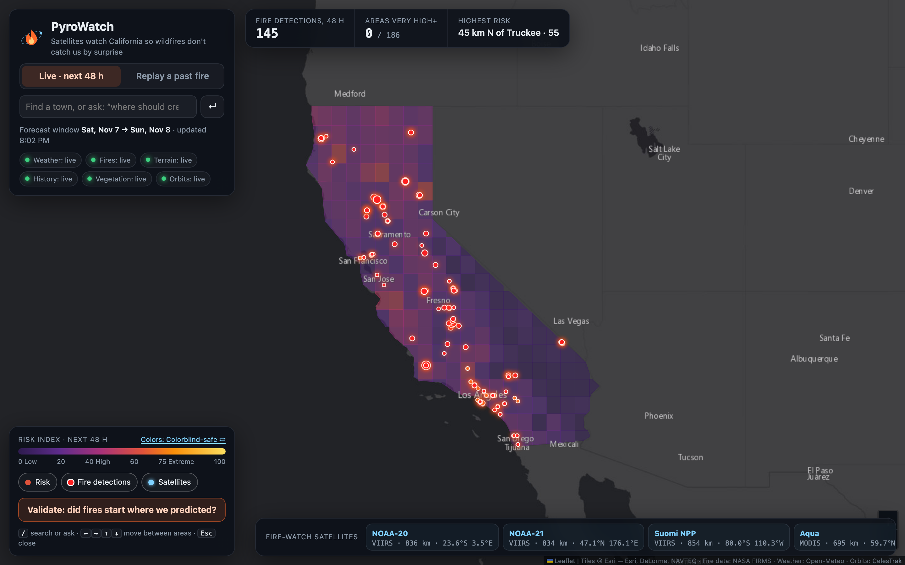
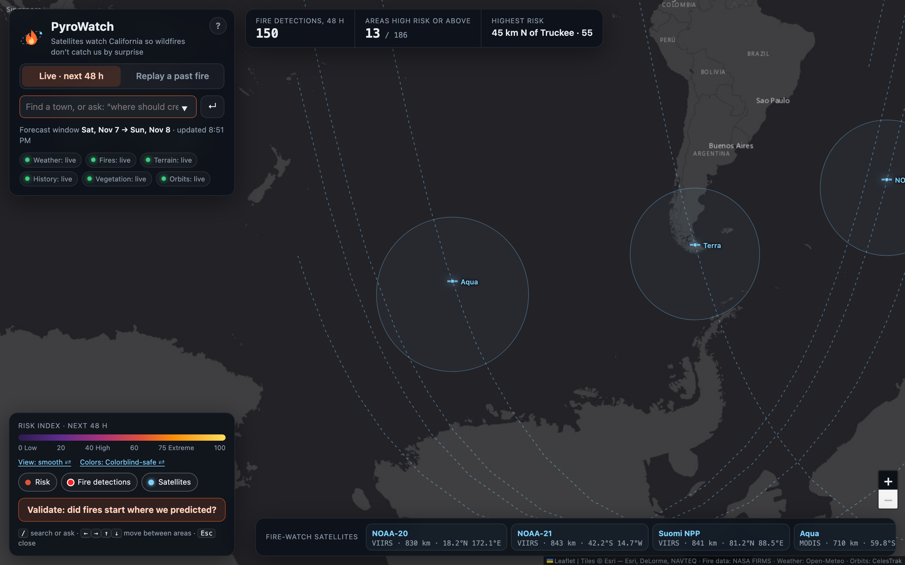
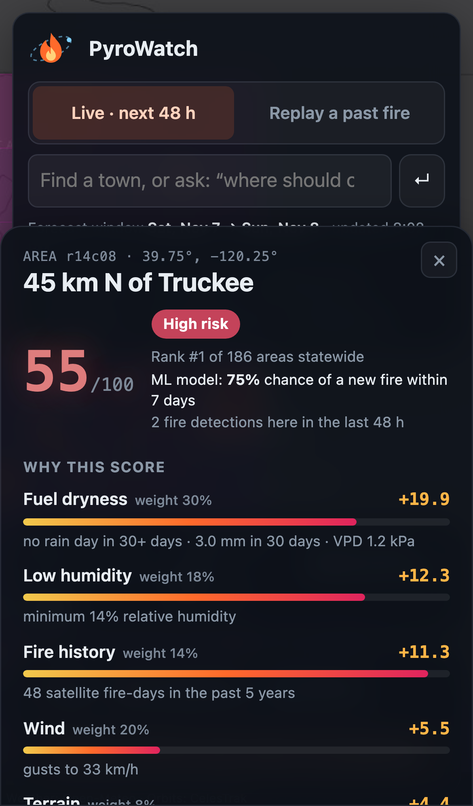
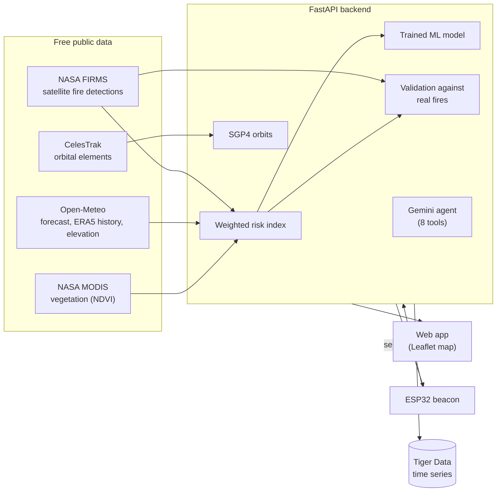

# PyroWatch 🛰️🔥

**Satellites watch California so wildfires don't catch us by surprise.**

PyroWatch scores wildfire risk for the next 48 hours across every 50 km area of California, shows
exactly why each area scores what it does, and checks itself against what NASA satellites actually
saw burn. Built at UB Hacking 2026.



> **The day before the January 2025 Los Angeles fires, PyroWatch ranked the areas where the
> Palisades and Eaton fires started #1 and #2 of 186 in California**, using only data available
> that day.

## Results

We replayed four historical fire events on real data. For each one we take the risk map as it stood
the day before, then check where **significant new fires** (fire intensity peaking above 50 MW)
started over the next three days. Reproduce with `python scripts/check_presets.py`.

| Event (prediction date) | Significant new fires in our top 20% | Lift vs random | ROC AUC | Fosberg index alone |
|---|---|---|---|---|
| LA windstorm: Palisades and Eaton (Jan 6, 2025) | 2 of 3 | 3.3× | 0.84 | 3 of 3 |
| Camp and Woolsey fires (Nov 7, 2018) | 6 of 9 | 3.3× | 0.80 | 4 of 9 |
| Wine Country fires, Tubbs (Oct 8, 2017) | 9 of 16 | 2.8× | 0.85 | 4 of 16 |
| Lightning siege, SCU and LNU complexes (Aug 16, 2020) | 4 of 18 | 1.1× | 0.74 | 3 of 18 |
| **All four events** | **21 of 46** | **2.3×** | | 14 of 46 (1.5×) |

- **PyroWatch caught 50% more of the major fires** than the standard Fosberg Fire Weather Index, a
  weather-only index used in National Weather Service fire-weather products. Weather alone points
  at deserts and dry valleys with nothing to burn; fuel dryness, vegetation and fire history fix that.
- **A trained model beats the hand-built score** on a season it never saw. Trained on the
  July–October 2021 and 2022 fire seasons and tested on 2023: ROC AUC **0.70**, against 0.61 for our
  weighted score and 0.45 for the Fosberg index alone.
- **Where it falls short:** lightning-started fires score close to random (1.1×), because the model
  has no lightning input. Random guessing scores 1.0× lift and 0.5 AUC.

## What it does

| | |
|---|---|
|  **Replay, reveal, validate.** Replay a past fire using only data from the day before, reveal what satellites saw burn next, and get the hit rate, lift over random and AUC. |  **Live 48-hour risk map.** Every 50 km area of California, with NASA satellite fire detections from the last 48 hours. |
|  **The satellites doing the watching.** NOAA-20, NOAA-21, Suomi NPP, Aqua and Terra, propagated live from their orbital elements, with ground tracks and sensor footprints. |  **Works anywhere.** Phone layout, colorblind-safe colors, full keyboard and screen-reader support. |

- **Every score shows its work.** Click an area to see how many points each factor adds, the
  standard Fosberg index next to it, and the trained model's 7-day fire probability.
- **Three selectable hazard outlooks.** The map also scores thunderstorm potential from peak
  hourly CAPE and blizzard conditions from 48-hour snowfall, wind and cold. Each has an area-level
  factor breakdown and preparedness suggestions; these are screening indices, not probabilities
  or official warnings. Existing wildfire scores remain the default and `/api/beacon` wildfire
  fields remain unchanged.
- **Ask PyroWatch.** Type a town to jump to it, or ask a question. A Gemini agent answers by calling
  eight of PyroWatch's own tools (area lookup, comparisons, fires nearby, satellite passes,
  validation, ground stations), and lists every call above its answer.
- **Plain-language briefings** written by Gemini for each area, optionally read aloud (ElevenLabs).
- **PyroWatch Beacon.** An ESP32 that watches one town: a servo dial shows its risk, a buzzer sounds
  when risk spikes or satellites spot fire nearby, and its temperature and humidity sensor reports
  back to the map as a ground station.
- **Guided tour.** First-time visitors get a one-minute tour; `?tour=1` loops it for an expo screen.

## How it works



### The risk score

Each 0.5° area (~50 km; 186 cover California) gets a **risk index from 0 to 100**. It is a relative
index, not a probability; the trained model supplies the probability.

```
points_i  = 100 × weight_i × factor_i × fuel_gate × veg_gate        risk = Σ points_i
fuel_gate = 0.35 + 0.65 × fuel_dryness       wet vegetation damps the weather factors
veg_gate  = 0.2 + 0.8 × vegetation           bare desert can't rank high
```

| Factor | Weight | Measured as (0 → 1) | Source |
|---|---|---|---|
| Fuel dryness | 30% | days since ≥2 mm rain (0→30), 30-day rain (60→0 mm), 7-day vapour-pressure deficit (0→4 kPa) | Open-Meteo |
| Wind | 20% | max gusts in the 48 h window, 15 → 70 km/h | Open-Meteo forecast |
| Low humidity | 18% | min relative humidity, 50% → 5% | Open-Meteo forecast |
| Fire history | 14% | satellite fire-days in the area over the previous 5 years (log scale) | NASA FIRMS archive |
| Heat | 10% | max temperature, 15 → 40 °C | Open-Meteo forecast |
| Terrain | 8% | elevation variability across the area (0 → 450 m std. dev.) | Open-Meteo elevation |
| Vegetation | multiplier | spring NDVI 0.10 → 0.40 (×0.2 → ×1.0) | NASA MODIS MOD13Q1, April 2016 (before every replay) |

The panel breakdown is exactly these points. Replays only use data that existed on the replay date:
weather up to that day, fire history from the five years before, and vegetation from 2016.

The **thunderstorm index** scales peak hourly CAPE (J/kg) over the 48-hour window to 0–100; CAPE
describes atmospheric instability, not the probability of lightning or a storm. The **blizzard
index** combines 48-hour snowfall (cm), forecast gusts and cold, and gates wind/cold contributions
by snowfall so they cannot produce a high score without accumulating snow. Both are relative
screening indices, not official forecasts or alerts. Open-Meteo's hourly `cape` and `snowfall`
measurements feed these calculations; demo mode produces deterministic synthetic hourly values.

### Validation

For a start date D, take the prediction as of D (a prediction recorded in advance if one exists,
otherwise a hindcast from data up to D), then look at NASA FIRMS detections from D to D+2. A
**significant new fire** is an area whose detections peak above 50 MW of fire intensity in at least
two detections, with no such fire there in the five days before. Detections labelled as industrial,
volcanic or offshore are dropped.

We first counted any area with at least five detections; the first real-data run showed winter pile
and farm burns producing dozens of 5–30 MW detections, so we switched to intensity. That change came
after seeing the data, which is why the panel and the script always show the all-hotspot numbers
next to the significant-fire ones.

Caveats, also shown in the app: satellites see farm, prescribed and industrial burns too; 50 km
areas test regional risk, not exact ignition points; hindcasts use observed weather in place of a
forecast.

### The ML model

`scripts/train_model.py` builds one sample per area per week of each fire season, with the same
measurements the score uses plus the Fosberg index, labelled "a new fire was detected in this area
within 7 days". It trains logistic regression and gradient boosting on earlier years, tests on the
last year, and compares both with the weighted score and the Fosberg index on that same year. The
strongest signals: past fires in the area, vegetation, season, then low humidity.

```bash
python scripts/train_model.py --years 2021 2022 2023 --season 7-10 --step 7
```

### The Gemini agent

"Ask PyroWatch" sends the question to Gemini with eight function declarations that run the same code
as the map: `find_area`, `top_areas`, `compare_areas`, `fires_near`, `satellite_passes`
(server-side SGP4), `statewide_summary`, `validation` and `ground_stations`. Gemini may chain several
calls; the results go back to it, and it answers only from them. Without a Gemini key, a keyword
router calls the same tools. `python scripts/check_gemini.py` tests the key, model and a tool call.

## Run it

```bash
git clone https://github.com/ZweHtetAung7/pyrowatch.git && cd pyrowatch
python3 -m venv .venv && source .venv/bin/activate      # Windows: .venv\Scripts\activate
python -m pip install -r requirements.txt
cp .env.example .env                                     # add keys (all optional)
python -m uvicorn backend.main:app --reload
```

Open http://localhost:8000. Python 3.10 or newer.

It runs **with no keys at all**: any source that isn't configured or doesn't respond falls back to
synthetic data, and the app shows a yellow **DEMO DATA** badge so synthetic data is never mistaken
for real. `PYROWATCH_DATA_MODE=demo` forces offline mode; `live` makes failures loud instead.

| Key in `.env` | Turns on | Get it |
|---|---|---|
| `FIRMS_MAP_KEY` | Live satellite fire detections | https://firms.modaps.eosdis.nasa.gov/api/map_key/ (free) |
| `GEMINI_API_KEY` | Briefings and the agent | https://aistudio.google.com/apikey |
| `ELEVENLABS_API_KEY` | Spoken briefings (optional) | elevenlabs.io |
| `DATABASE_URL` | Tiger Data time series: risk history chart, recorded predictions (optional) | Tiger Cloud |
| `STATION_TOKEN` | Shared secret beacons send with readings (optional) | any password |

Open-Meteo and CelesTrak need no key. Fire history (`data/fire_history.json`), vegetation
(`data/vegetation.json`) and the trained model (`data/model.joblib`) are committed; the scripts in
`scripts/` rebuild them.

**Deploy** on any Ubuntu server (we used Vultr): clone to `/opt/pyrowatch`, add `.env`, then
`sudo bash deploy/setup_vultr.sh your-domain` installs a systemd service behind Caddy with HTTPS.

**Hardware:** parts, wiring and flashing steps for the beacon are in [firmware/README.md](firmware/README.md).

## Project layout

```
backend/
  main.py      FastAPI routes; serves the frontend
  sources.py   NASA FIRMS, Open-Meteo (forecast, ERA5, elevation), MODIS vegetation, CelesTrak; caching, fallbacks
  risk.py      features → factor scores → weighted index; Fosberg index; validation; prediction ledger
  agent.py     "Ask PyroWatch": Gemini function-calling agent over 8 tools
  ai.py        Gemini briefings, ElevenLabs voice
  orbits.py    server-side SGP4 satellite passes
  ground.py    ground-station readings from beacons
  store.py     Tiger Data / PostgreSQL time series (optional)
  geo.py, demo.py   California grid and place names; synthetic data for offline mode
frontend/      index.html, app.js (Leaflet, satellite.js), style.css
scripts/       check_presets, train_model, build_fire_history, fetch_vegetation, check_gemini, capture_screenshots
firmware/      PyroWatch Beacon: ESP32 sketch and wiring guide
deploy/        server setup script, systemd unit, Caddyfile
data/          fire history, vegetation, trained model, recorded predictions, preset results
```

API docs are served at `/docs` when the app is running.

## Team

Built at UB Hacking 2026 by **Min** (data and hardware), **Zwe Aung** (model and validation),
**Oak** (map and UI) and **Su** (AI, deploy and pitch), from the University at Buffalo and SUNY Oswego.

## Credits

Data: NASA FIRMS (VIIRS and MODIS active fires), NASA MODIS MOD13Q1 via the ORNL DAAC, Open-Meteo
(forecast, ERA5 reanalysis, elevation), CelesTrak (orbital elements). Map tiles © Esri. Libraries:
Leaflet, satellite.js, sgp4, FastAPI, scikit-learn. Gemini powers the briefings and the agent.
Development was assisted by Claude Code (Anthropic). Team planning notes: [docs/HACKATHON.md](docs/HACKATHON.md).
